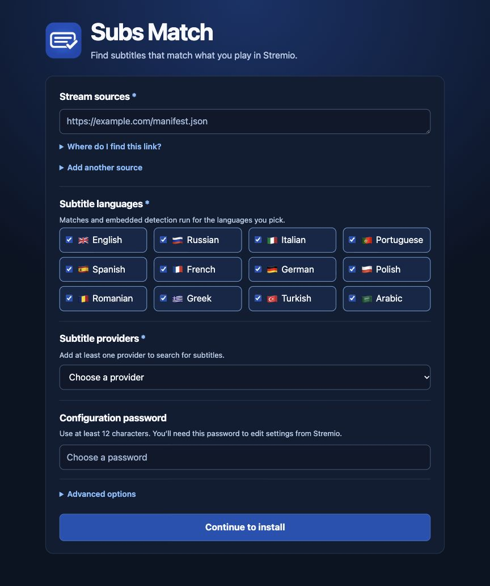
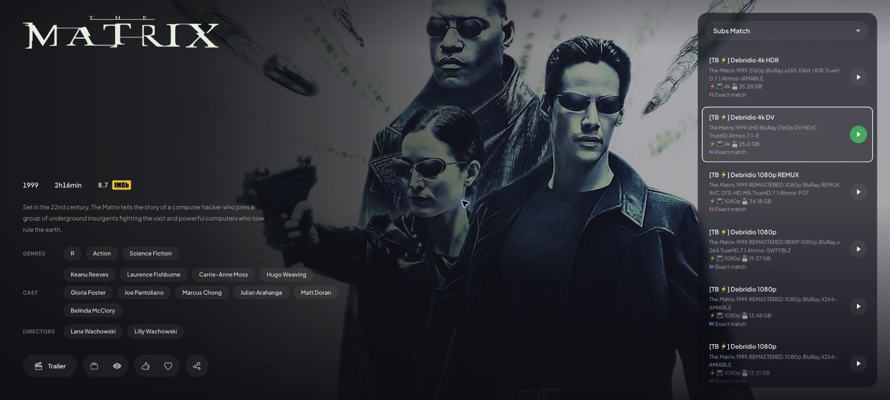

<p align="center">
  
</p>

<h1 align="center">Subs Match for Stremio</h1>

<p align="center">
  Ranked subtitle matches, saved timings, and embedded-sub detection.<br>
  Right inside Stremio — in the languages you choose.
</p>

<p align="center">
  
  
  
</p>

<p align="center">
  <a href="#install-in-stremio">Install</a> ·
  <a href="#screenshots">Screenshots</a> ·
  <a href="#features">Features</a> ·
  <a href="#languages">Languages</a> ·
  <a href="#run-on-a-mac">Run on a Mac</a> ·
  <a href="#host-on-a-vps">Host on a VPS</a> ·
  <a href="#labels-and-timing">Labels &amp; timing</a> ·
  <a href="#subtitle-providers">Providers</a> ·
  <a href="#development">Development</a> ·
  <a href="#license">License</a>
</p>

Subs Match sits between your stream add-on and Stremio. It ranks playable streams by how well the available subtitles match each release — and it marks the streams that already carry subtitles inside the video file.

## Install in Stremio

For a new hosted installation, add a stream add-on manifest and at least one subtitle provider API key, choose your languages, and set a configuration password. Select **Continue to install**, then **Install in Stremio**. In Stremio Web, you can also use **Copy install link** and paste it into **Addons → Add addon**. [Hosted Configure page](https://subsmatch.johncodeos.com/configure)

**Upgrading from Greek Sub Match.** Subs Match v0.4.0 uses a new Stremio add-on ID. If **Addons → Installed** still shows **Greek Sub Match**, open **Configure** on that entry and unlock your existing settings. Use its install link to add **Subs Match**. Once **Subs Match** appears in Stremio, uninstall **Greek Sub Match** to avoid duplicate streams. Reusing your existing installation preserves your stream sources, keys, and saved subtitle timings.

### Show Subs Match first

To put the **Subs Match** results at the top of the stream list, move **Subs Match** above the add-ons that supply your streams, such as Debridio or Torrentio.

1. Open a third-party add-on manager and sign in with the same Stremio account. [CineBye](https://cinebye.elfhosted.com/)
2. Drag **Subs Match** above your stream provider add-ons and sync the new order to your account.
3. Reload Stremio Web and reopen the movie or episode.

## Screenshots

### Configure



### Stremio Web results



## Features

- **Release matching** — pairs subtitle release names with the streams of the same movie or episode. Saved timing confirmations and video hash matches rank first, then exact filenames, then likely releases. Shared listings such as `1080/720p YTS.AG` are understood, and each source, resolution, and release group is kept apart.
- **Embedded-sub detection** checks Matroska or MP4 track metadata over small ranged requests for up to 16 eligible streams per lookup. Release names can also provide hints, such as `GRE`, `Greek subs`, or `FRENCH`. Streams marked `Embedded` can join the shortlist on the strength of their built-in subtitles.
- **Matched shortlist** — up to 12 best streams per title, identical playback URLs collapsed into one.
- **Timing confirmations** — after checking playback once, save a delay for that exact file so the subtitles stay in sync every time.
- **Subtitle providers** — SubDL, OpenSubtitles, and SubSource, with SRT delivered as UTF-8 WebVTT (ZIP packs included).
- **Private by default** — install links carry a random access token, settings are stored with owner-only permissions, and passwords are kept as salted hashes.

## Languages

Pick one or more subtitle languages in Configure. Matching, embedded detection, and legacy-encoding conversion are tuned per language.

| Code | Language | Code | Language | Code | Language |
| --- | --- | --- | --- | --- | --- |
| `en` | English | `ru` | Russian | `it` | Italian |
| `pt` | Portuguese | `es` | Spanish | `fr` | French |
| `de` | German | `pl` | Polish | `ro` | Romanian |
| `el` | Greek | `tr` | Turkish | `ar` | Arabic |

Greek release-name tuning (`GRE`, `GR`, `Ελληνικά`…) is the deepest; the others follow their own release-name markers and native subtitle words. Portuguese also accepts Brazilian release forms (`PT-BR`, `BR`, `Brazilian`). Each subtitle is converted using its own language's legacy encoding — windows-1253 for Greek, windows-1251 for Russian, windows-1250 for Polish and Romanian, and so on — when it is not UTF-8.

## Run on a Mac

1. Double-click **`Start.command`** and leave its Terminal window open. You need Node.js 22 or later. The launcher can also use the Node.js bundled with ChatGPT when available.
2. Open **`http://127.0.0.1:7331/configure`** — or double-click `Configure.command`.
3. Paste the install link of a Stremio add-on that supplies playable streams — from **Addons → Installed → Share addon**, or its own setup page. It looks like `https://example.com/manifest.json`. A second source fits in the optional field below.
4. Enter at least one subtitle API key, check the subtitle languages you want, set a configuration password, and press **Save settings**.
5. Click **Install in Stremio**, or **Copy install link** and paste it into **Stremio Web → Addons → Add addon**.

Get API keys here: [SubDL](https://subdl.com/api-doc) · [OpenSubtitles](https://www.opensubtitles.com/en/consumers) · [SubSource](https://subsource.net/api-docs)

**Good to know**

- If Stremio Web cannot reach the local add-on in Chrome or Brave, allow **Apps on device** for `web.stremio.com` in that browser's site settings.
- After changing settings, refresh the movie or episode to see new results. The install link stays the same when settings or the password change.
- Saved stream links go in multiline boxes, one link per box. The eye button next to each API key reveals or hides it.
- Settings live in `.settings.json` with owner-only permissions. If you forget the configuration password, open the loopback Configure page on the host to set a new one.
- The installed add-on's **Configure** button in Stremio unlocks your saved settings. Local installations can also open `http://127.0.0.1:7331/manifest.json` directly.

## Host on a VPS

Run one instance per owner. The private install link grants Stremio access; the password you choose unlocks its Configure page. Keep first-time setup and password recovery available through SSH.

1. **Install** Node.js 22+, `unzip`, and [Caddy](https://caddyserver.com/docs/install) on the VPS. Point a hostname such as `addon.example.com` at it. Run the app as an unprivileged user in a persistent directory — keep port `7331` on loopback, open ports `80`/`443` for Caddy.
2. **Configure** — copy `.env.example` to `.env`, then `chmod 600 .env`:

   ```dotenv
   HOST=127.0.0.1
   PORT=7331
   PUBLIC_URL=https://addon.example.com
   ```

3. **Route HTTPS** through Caddy. Only the generated install token paths are forwarded; everything else gets `404`, and the root Configure page stays on loopback. [Caddy HTTPS setup](https://caddyserver.com/docs/automatic-https)

   ```caddyfile
   addon.example.com {
       @stremio {
           method GET POST OPTIONS
           path_regexp ^/install/[a-f0-9]{64}/(manifest[.]json|addon-icon[.]png|stream/(movie|series)/[A-Za-z0-9:]+[.]json|track/[A-Za-z0-9_-]+[.][A-Za-z0-9_-]+[.]vtt|configure(/(check|reveal|logout|fields[.]js))?)$
       }
       handle @stremio {
           reverse_proxy 127.0.0.1:7331
       }
       handle {
           respond 404
       }
   }
   ```

4. **Run** the app with `node --env-file=.env src/server.js` under your service manager. Then open an SSH tunnel and visit `http://127.0.0.1:7332/configure` to save stream links, API keys, languages, preferences, and the configuration password. [OpenSSH port forwarding](https://man.openbsd.org/ssh.1)

   ```sh
   ssh -N -L 127.0.0.1:7332:127.0.0.1:7331 your-user@addon.example.com
   ```

5. **Install** with **Install in Stremio** or **Copy install link**. Check that the generated HTTPS manifest loads — and that the bare `/manifest.json` and `/configure` return `404`, while the installed add-on's **Configure** button opens the password prompt.

**Keep credentials private.** Anyone with a private install link can fetch its stream results. Keep install links, source manifests, and provider keys out of public posts and Git history. Limit access to application and proxy logs and redact install tokens before sharing logs. Store `.env`, `.settings.json`, `.confirmations.json`, `.probe-cache.json`, and `.installations/` on the VPS and in private backups. [GitHub guidance on storing secrets](https://docs.github.com/en/get-started/learning-to-code/storing-your-secrets-safely)

## Shared Configure page

To let other people install from one hosted site, deploy the VPS setup above with `PUBLIC_SIGNUP=1` in `.env`. On the public hostname, each visitor opens `/configure`, enters a stream add-on link and a subtitle API key, picks languages, sets a password, and selects **Continue to install**. The next screen offers **Install in Stremio** and **Copy install link**. Visitors can unlock their saved settings with **Configure** in Stremio. The host administrator keeps using the loopback address through the SSH tunnel.

Add this block to the same Caddy site, next to the private installation matcher, keeping the fallback `404` handler:

```caddyfile
@signup {
    method GET POST
    path / /configure /configure/fields.js /addon-icon.png
}
handle @signup {
    reverse_proxy 127.0.0.1:7331
}
```

Shared-page users must supply stream add-on manifest URLs on public HTTPS hostnames — local addresses, this add-on's own hostname, and redirecting stream endpoints are rejected. The server validates and pins the public DNS address before connecting to each user-supplied source. Add VPS network rules to block outbound access to private infrastructure as a second layer. [OWASP guidance on server-side requests](https://cheatsheetseries.owasp.org/cheatsheets/Server_Side_Request_Forgery_Prevention_Cheat_Sheet.html)

Keep `.installations/` in private, persistent storage with your other settings. It holds separate provider keys, salted password hashes, and timing confirmations per installation. This mode is designed for one Node process per data directory, supports up to 200 installations, and rate-limits signups and stream requests.

## Labels and timing

Every marker in the stream details starts with the flag of the matched language. Here is what they mean (shown for Greek):

| Label | Meaning |
| --- | --- |
| `🇬🇷 Embedded` | Greek subtitles are already inside the video file — nothing to download |
| `🇬🇷 Exact match` | A subtitle file with the exact release name is available |
| `🇬🇷 Greek subtitles · Likely · …` | A probable release match (group, source, or resolution lines up) |
| `🇬🇷 Video hash match` | The provider verified this subtitle against the file's video hash |
| `🇬🇷 Confirmed timing` | You checked playback and saved the sync for this file |

Other languages use the same wording with their own flag and name — `🇫🇷 French subtitles · Likely · …`, `🇷🇺 Embedded`, and so on. A stream can show two markers at once, for example `🇬🇷 Embedded · Exact match`. Use **Exact and likely match label position** in Configure to place the labels at the start, after the first line, or at the end of the stream details.

**Stream list.** By default the **Matched shortlist** shows up to 12 streams with matching subtitles and collapses identical playback URLs. When nothing matches, a message opens the title check instead. Choose **All streams, matches first** to keep every stream in one list.

**Checking a title.** Open **Check a movie or episode** in Configure and paste a Stremio detail link, IMDb ID, or TMDB ID. You get the stream count, each subtitle provider's status, and the release details behind the best matches.

**Saving a timing.** After playback, find the stream by the short File ID shown on its subtitle label and press **Timing is good**. Enter an optional delay in seconds — a positive number shows the subtitles later, a negative number earlier. **Remove confirmation** undoes it. Confirmations are stored in `.confirmations.json` and apply to the identified playback file via its video hash, file name plus byte size, or exact playback source.

## Subtitle providers

- **SubDL** — searches by IMDb or TMDB ID, and retries with the release filename when needed. ZIP packs are scanned for the right episode.
- **OpenSubtitles** — REST API on the anonymous download quota. (The separately installed *OpenSubtitles v3* add-on does not hand this matcher an API key.) Falls back to a second results page or a representative release filename, and uses video hashes supplied by the stream add-on for hash lookups.
- **SubSource** — searches by IMDb ID using release names, for both movies and episodes.

All providers serve SRT as UTF-8 WebVTT. If one provider is unavailable, the others still supply matches. IMDb and TMDB IDs are supported, including AIOMetadata episode IDs such as `tmdb:123456:2:3` — if a source returns no streams for an ID, try its Cinemeta listing. Release metadata is used to estimate timing compatibility.

## Development

Run `node --test` from this folder with Node.js 22 or later. The ZIP tests use `/usr/bin/zip` to create fixtures and `/usr/bin/unzip` to read them. The suite covers local settings, stream ranking, ZIP episode selection, embedded-subtitle detection, multi-language matching, and simulated subtitle API search and downloads.

## License

Released under the [MIT License](LICENSE).
